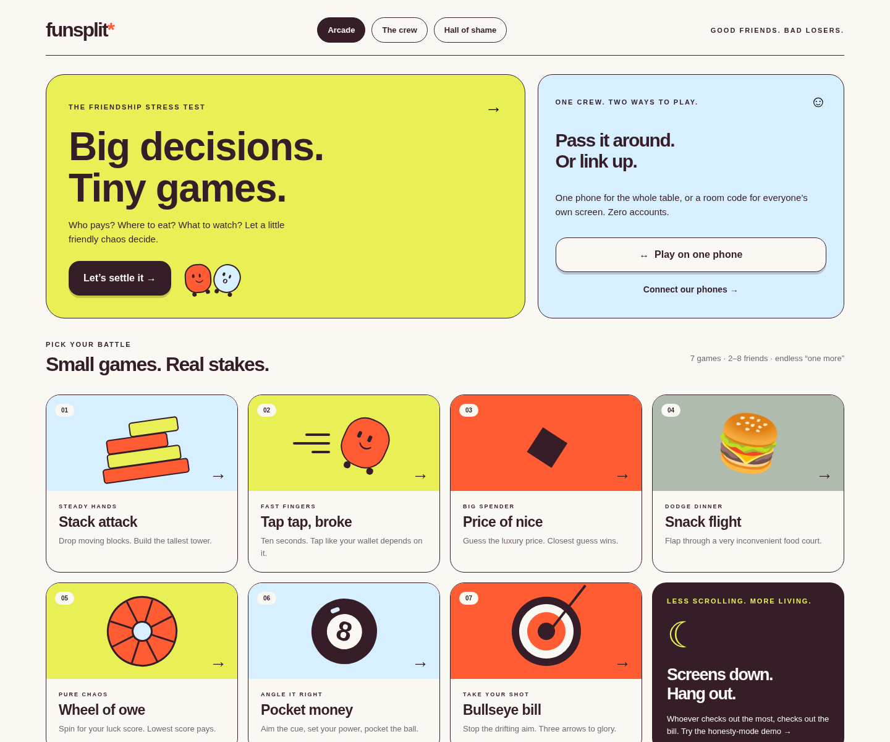

# funsplit ✳

**Big decisions. Tiny games.** A React Native / Expo party app for deciding who pays, where to eat, and what to watch. All seven candidate games are playable in this demo so the group can choose what stays.



## Run

Node.js 22.13+ (Node 24 recommended), npm, and Expo Go compatible with SDK 58, or an Expo development build.

```sh
npm ci
npm start
# w = web, a = Android, i = iOS (iOS simulator requires macOS)
```

For a browser directly: `npm run web`. For Android/iOS development builds: `npm run android` / `npm run ios`. Haptics run on supported native devices; web vibration is a best-effort fallback. A device/simulator build is still needed to verify native haptics and lifecycle behaviour.

### Individual phones

```sh
# Terminal 1
npm run server
# Terminal 2
npm start
```

Use **Connect our phones**, enter a reachable server URL (for example `http://192.168.1.10:3001` on the same Wi-Fi), choose a name and character, and create a room. Friends enter the same server URL and six-character room code. Never use `localhost` to address another computer from a phone. Optionally set `EXPO_PUBLIC_ROOM_URL` using `.env.example`. Native release builds should use a trusted HTTPS endpoint; local HTTP support varies by platform/build configuration.

The host starts and configures games. Each player controls their own turn from their own screen. Other screens show who is playing. Connected play is **turn-based**, including Tap Race; simultaneous racing is a later milestone. Disconnecting a player returns the room to its lobby and transfers hosting if needed. Rooms live in server memory and expire after six hours. This server is a working demo, not a deployed service.

## Included

- **Stack attack:** moving blocks, overlap trimming, 20-second limit, 12-level cap.
- **Tap tap, broke:** a ten-second tap race, one player at a time.
- **Price of nice:** illustrative luxury items / dinner prices; smallest absolute error wins. USD demo data, not a live catalogue.
- **Snack flight:** gravity, flap control, food columns, collisions, gate scoring.
- **Wheel of owe:** animated spin and 1–100 luck score per player. Lowest loses.
- **Pocket money:** one-shot billiards with cue/object collision, friction, cushion bounces, corner pockets, scratches and distance-based near-miss scores. Simplified 2D physics, not a full ruleset of eight-ball.
- **Bullseye bill:** drifting aim, three arrows, distance-based scoring.
- Custom local player names and four character silhouettes, 2–8 people.
- Single-phone and room-based play, repeated games or mixed tournaments over 1/3/5/7 rounds.
- Per-round rank points normalize incompatible game scores. Shared ranks preserve ties. Lowest total pays; highest total earns the decision. Tied groups agree or rematch.
- Winner chooses from a custom restaurant/movie shortlist. These decisions never increment payment counts.
- Animated loser reveal, a teasing roast, native haptic hooks.
- Local, persistent **Hall of shame**, updated only when a payment is confirmed. No money is charged or transferred. Each device maintains its own history.
- **Screens down honesty demo:** voluntary check-ins and a native app-background-time proxy attributed to a selected player. Clearly labelled; no claim to measure other apps or total screen time. Web uses manual check-ins only.

## Validate

```sh
npm run typecheck
npm test
npm run build
npm run test:e2e
```

Browser tests default to `/usr/bin/chromium`; set `CHROMIUM_PATH` for another installation, or adapt the Playwright launch configuration to a downloaded browser. See [validation](docs/VALIDATION.md) for what was actually verified.

## Read next

- [Product and experience plan](docs/PRODUCT.md)
- [Architecture and engineering roadmap](docs/ARCHITECTURE.md)

Palette: `#E9F056` (the supplied `#e9fo56` interpreted as a zero), `#FF5C34`, `#D7EFFF`, `#351E28`, `#AEBBAD`.
