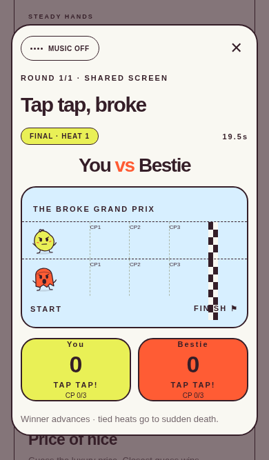
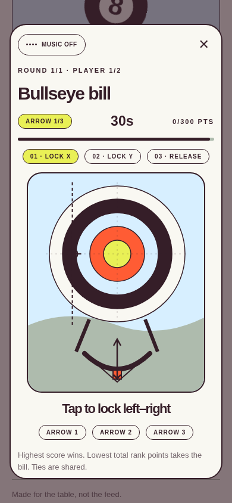
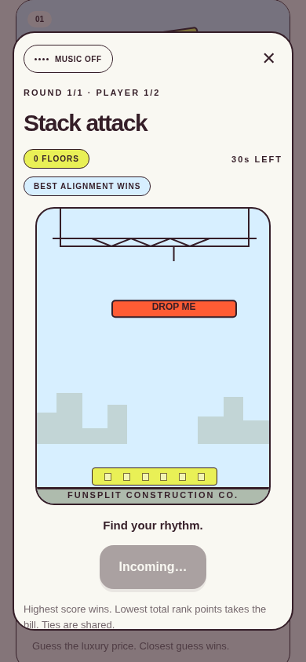

# funsplit ✳

**Big decisions. Tiny games.** A React Native / Expo party app for deciding who pays, where to eat, and what to watch. All seven candidate games are playable in this demo so the group can choose what stays.


## Run

Node.js 22.13+ (Node 24 recommended), npm, and Expo Go compatible with SDK 58, or an Expo development build.

```sh
npm ci
npm start
# w = web, a = Android, i = iOS (iOS simulator requires macOS)
```

For a browser directly: `npm run web`. For Android/iOS development builds: `npm run android` / `npm run ios`. Haptics run on supported native devices; web vibration is a best-effort fallback. A device/simulator build is still needed to verify native haptics and lifecycle behaviour.

### Individual phones

```sh
# Terminal 1
npm run server
# Terminal 2
npm start
```

Use **Connect our phones**, enter a reachable server URL (for example `http://192.168.1.10:3001` on the same Wi-Fi), choose a name and character, and create a room. Friends enter the same server URL and six-character room code. Never use `localhost` to address another computer from a phone. Optionally set `EXPO_PUBLIC_ROOM_URL` using `.env.example`. Native release builds should use a trusted HTTPS endpoint; local HTTP support varies by platform/build configuration.

The host starts and configures games. Each player controls their own turn from their own screen. Other screens show who is playing. Most connected games use individual turns. **Tap tap, broke is a shared-screen knockout bracket:** two friends play simultaneously on the host’s phone, then the host posts the whole bracket’s results to the room. Disconnecting a player returns the room to its lobby and transfers hosting if needed. Rooms live in server memory and expire after six hours. This server is a working demo, not a deployed service.

## Included

- **Stack attack:** crane drops, animated falling blocks, perfect landings, falling offcuts, overlap trimming, a 30-second limit and 12-floor cap.
- **Tap tap, broke:** 2–8 player knockout bracket, simultaneous independent tap pads, countdown, three checkpoints, finish stripe, confetti, byes for odd crews and sudden-death ties. First to 60 taps; after 20 seconds the leader wins.
- **Price of nice:** real Gucci bag, belt and sneaker photo cards with style IDs, descriptions and dated US retail snapshots. Closest guess wins. Answers and official source links reveal after all guesses. Photos stream from Gucci and require internet.
- **Snack flight:** gravity, flap control, food columns, collisions, gate scoring.
- **Wheel of owe:** a labelled ten-sector wheel, animated spin, matching pointer result and 10–100 luck score. Lowest loses.
- **Pocket money:** one-shot billiards with cue/object collision, friction, cushion bounces, corner pockets, scratches and distance-based near-miss scores. Simplified 2D physics, not a full ruleset of eight-ball.
- **Bullseye bill:** 30 seconds per arrow: lock horizontal aim, lock vertical aim, then watch the bow release and arrow fly. Three arrows, distance scoring, zero for expired arrows.
- Custom local player names and four original doodle characters with sketch outlines, hands, feet, accessories and expressions, 2–8 people.
- Single-phone and room-based play, repeated games or mixed tournaments over 1/3/5/7 rounds.
- Per-round rank points normalize incompatible game scores. Shared ranks preserve ties. Lowest total pays; highest total earns the decision. Tied groups agree or rematch.
- Winner chooses from a custom restaurant/movie shortlist. These decisions never increment payment counts.
- Animated loser reveal, confetti, a teasing roast, native haptic hooks.
- Original bundled arcade music: tap **Music off** to start, use the same control to mute. Audio pauses when the app backgrounds. No third-party samples or streaming dependency.
- Local, persistent **Hall of shame**, updated only when a payment is confirmed. No money is charged or transferred. Each device maintains its own history.
- **Screens down honesty demo:** voluntary check-ins and a native app-background-time proxy attributed to a selected player. Clearly labelled; no claim to measure other apps or total screen time. Web uses manual check-ins only.

## Update an existing checkout

```sh
git pull
npm ci
npx expo start --go --clear
```

If you run connected rooms, restart `npm run server` too; the new race-bracket event needs the updated server.

## Validate

```sh
npm run typecheck
npm test
npm run build
npm run test:e2e
```

Browser tests default to `/usr/bin/chromium`; set `CHROMIUM_PATH` for another installation, or adapt the Playwright launch configuration to a downloaded browser. See [validation](docs/VALIDATION.md) for what was actually verified.

## Read next

- [Product and experience plan](docs/PRODUCT.md)
- [Architecture and engineering roadmap](docs/ARCHITECTURE.md)
- [Photos, price sources and original music](docs/ASSETS.md)

Updated game screens:





Palette: `#E9F056` (the supplied `#e9fo56` interpreted as a zero), `#FF5C34`, `#D7EFFF`, `#351E28`, `#AEBBAD`.
